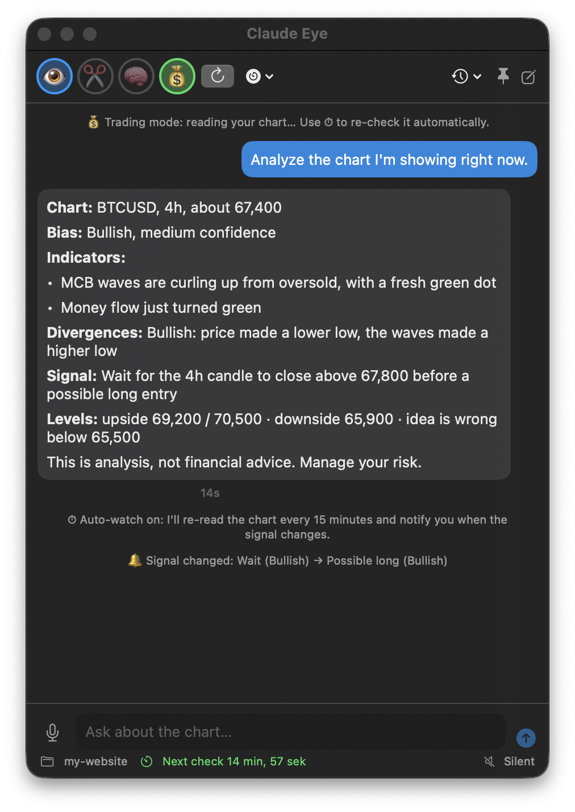
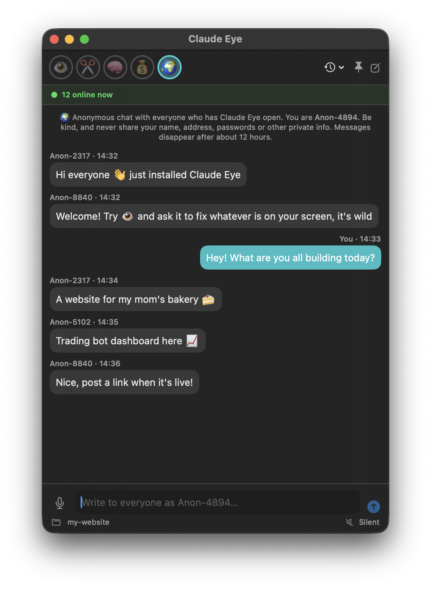

# 👁️ Claude Eye

A floating chat window for macOS that lets [Claude Code](https://claude.com/claude-code) **see your screen**.
Turn on the eye, point at anything (a website, an app, a design, a chart) and say what you want:
*"what's wrong with this page?"*, *"build this in my app"*, *"make this look nicer"*.

> **Unofficial.** Claude Eye is a community project. It is not made by, affiliated with, or endorsed by Anthropic.
> It runs the `claude` command you already have installed and uses your own Claude Code login.

<p align="center">
  
  
</p>
<p align="center"><sub>Left: 💰 Trading mode reading a chart. Right: the 🌍 global chat (example messages).</sub></p>

## Features

### 👀 Show Claude your screen

| | |
|---|---|
| 👁️ **Screen sharing** | Turn it on and Claude sees your screen with every message |
| ✂️ **Snip** | Drag a box to show just one part of the screen |
| 📁 **Project folder** | Say *"build what I'm showing you"* and Claude makes it in your project |

### 💬 Chat your way

| | |
|---|---|
| 🎙 **Voice** | Talk instead of typing. 🔊 reads answers out loud |
| 💾 **History** | Your chats are saved. 🕘 opens older ones |
| 🔔 **Notifications** | Get pinged when an answer is ready |

### 🎯 Special modes

| | |
|---|---|
| 🧠 **Business** | Money-making ideas with costs, first steps and risks |
| 💰 **Trading** | Reads your TradingView chart: trend, indicators (incl. Market Cipher B) and signals |
| ⏱ **Auto-watch** | Re-checks the chart every 5 or 15 min and alerts you when the signal changes |

### 🌍 Global chat

Talk live and anonymously with everyone who has Claude Eye open.
You get a random name like *Anon-4821*, and a green bar shows how many people are online.

### ⚡ Always handy

Floats on top of every window. Press **⌃⌥Space** to show or hide it from anywhere.

## Requirements

- macOS 13 Ventura or later
- [Claude Code](https://claude.com/claude-code) installed and logged in (run `claude` once in Terminal)
- Apple's command line tools: `xcode-select --install`

## Install

```sh
git clone https://github.com/SKRUTNITZ/claude-eye.git
cd claude-eye
./scripts/setup-signing.sh   # optional, recommended: keeps the screen permission across rebuilds
./build.sh --open            # builds, installs to ~/Applications and launches
```

The first time you turn on 👁️, macOS asks for **Screen Recording** permission. Turn on Claude Eye in
System Settings → Privacy & Security → Screen & System Audio Recording, then quit (⌘Q) and reopen the app.

## Shortcuts

| Keys | Action |
|---|---|
| ⌃⌥Space | Show / hide Claude Eye (works from any app) |
| Return | Send |
| ⌥Return | New line |
| Esc | Stop Claude |
| ⌘E | Screen sharing on/off |
| ⌘⇧S | Snip part of the screen |
| ⌘D | Talk (press again to send) |
| ⌘R | Read the chart (turns on 💰 Trading mode) |
| ⌘N | New chat |
| ⌘O | Choose project folder |

Start straight into a mode with `open -a "Claude Eye" --args --mode trading` (or `business`).
`--args --demo` opens an example chat without saving anything (used for the screenshots above).
Add `--globe` to show an example 🌍 room instead.

## Permissions

macOS asks for each one the first time you use the feature:

| Permission | Needed for |
|---|---|
| Screen & System Audio Recording | 👁️, ✂️ and 💰 |
| Microphone + Speech Recognition | 🎙 voice input |
| Notifications | 🔔 answer-ready and signal-change alerts |

## Privacy and safety

- Screenshots are only taken when 👁️ is on, and only when you send a message (or press 🔄 / 💰).
- They're saved in `~/Library/Application Support/ClaudeEye/screenshots` and sent to Claude through Claude Code,
  the same way as any file Claude reads. Screenshots older than 24 hours are deleted when the app starts.
  Everything visible on your screens is included, so close anything private first.
- Claude runs in **accept-edits** mode inside your project folder: it can create and change files there without
  asking, but it **can't run terminal commands** from the overlay. Use `claude` in Terminal for that.
  The default folder is `~/Claude Eye Workspace`, so Claude can't touch the rest of your files until you pick a folder.
- In 💰 Trading mode, Claude may use read-only TradingView connector tools (prices, symbol info, ratings, news)
  if you've connected them. It can't place trades or change alerts.
- ⏱ Auto-watch takes a new screenshot on its own every 5 or 15 minutes while it's on, and only in Trading mode.
  Leaving Trading mode turns it off.
- Chat history is stored on your Mac in `~/Library/Application Support/ClaudeEye/history.json`
  (🕘 → Clear History deletes it). Voice input uses Apple's speech recognition.
- 🌍 Global chat messages go through the free public relay [ntfy.sh](https://ntfy.sh) and are kept there for about
  12 hours. They're **public**: anyone who knows the room name can read and write, and there's no moderation.
  Only your random nickname and message are shown to others, but ntfy.sh (like any website) can see your IP address.
  Never share personal info there. While 🌍 is on, the app sends a small "I'm here" ping every 4 minutes for the
  online count. Nothing is sent when 🌍 is off. Messages from strangers are shown as plain text (no clickable links).
- A log for troubleshooting is at `~/Library/Logs/ClaudeEye.log` (Chat → Open Log). It doesn't contain your messages.

## Not financial advice

Trading mode describes what it sees on a chart. It can misread small details, and nobody can predict markets.
Treat it as a second opinion, always use a stop-loss, and only risk money you can afford to lose.

## Troubleshooting

**The permission switch is on, but Claude only sees my wallpaper / it keeps asking.**
macOS remembers an older build. Reset it and grant it again:
```sh
tccutil reset ScreenCapture local.claudeeye
```
Running `scripts/setup-signing.sh` once stops this from happening after rebuilds.

**"Couldn't find Claude Code."** Install Claude Code and run `claude` once in Terminal so you're logged in.

**Build fails with `redefinition of module 'SwiftBridging'`.** `build.sh` works around this known Command Line
Tools issue automatically. If you build by hand, reinstall the tools or use `build.sh`.

## How it works

Claude Eye is one SwiftUI file (`Sources/main.swift`). Each message runs
`claude -p … --output-format stream-json --resume <session>` in your project folder and streams the reply back.
Screenshots are taken with macOS's built-in `screencapture` and passed to Claude as image files.

## License

[MIT](LICENSE)
